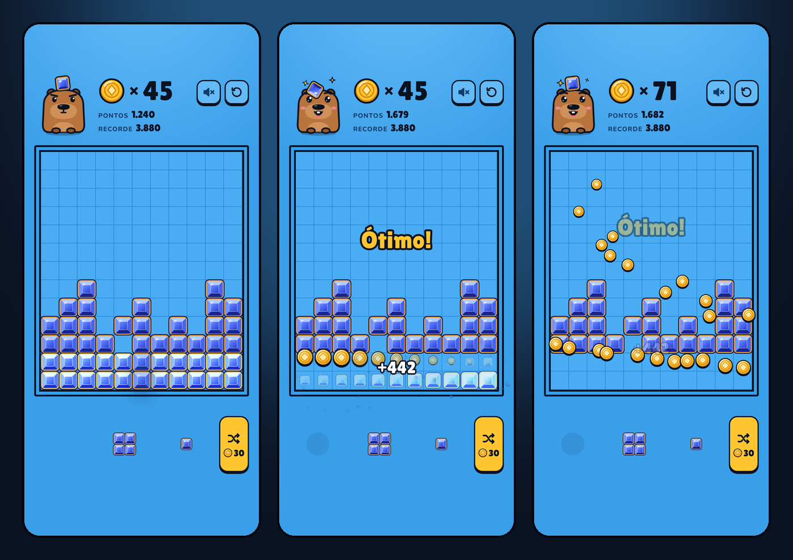

# Lazuli Arcade

Terror em primeira pessoa e oito clássicos para celular e desktop, em React e TypeScript. Um lobby leve, jogos independentes que só baixam quando são abertos e progresso salvo no próprio aparelho. Roda como PWA instalável (offline) e também como um único arquivo HTML autocontido.

**Jogar:** [renanfrontend.github.io/lazuli-arcade](https://renanfrontend.github.io/lazuli-arcade/)



## Experiências em destaque

### Último Espetáculo

Terror em primeira pessoa numa mansão abandonada, com bonecas que acompanham seu olhar e um palhaço perseguidor. Encontre três peças da caixa de música, volte ao hall para montar o mecanismo e escape pela porta.

- Cenário 3D em WebGL, com materiais deteriorados, painéis de madeira, cortinas, móveis, brinquedos, lustres e lanterna dinâmica.
- WASD anda; arraste a tela para olhar ou use as setas esquerda/direita. Shift corre, E interage, F liga a lanterna, M abre o mapa e Esc pausa.
- Controles na tela permitem segurar para caminhar ou tocar para dar um passo; há botões de câmera, corrida e interação.
- O palhaço desperta após a primeira peça, navega pelas portas, vê a lanterna e escuta corridas. Armários escondem você se ele não presenciou sua entrada.
- Passos, rangidos, riso, caixa de música e batimentos acompanham a ameaça. A captura provoca um susto e permite tentar de novo.
- O mapa marca peças ainda não encontradas. Fôlego se recupera ao parar de correr. Pausa congela a partida, e movimento reduzido desativa a trepidação.
- A rota antiga `#trilha-noturna` foi preservada para manter links já compartilhados.

## Clássicos e desafios

### Reversi

Estratégia em um tabuleiro 8 × 8 contra o computador, com interface escura e três dificuldades.

- Você joga com as pretas; capture peças em oito direções. Casas legais ficam marcadas.
- Iniciante escolhe jogadas legais aleatórias; intermediário e avançado usam busca alpha-beta, mobilidade e controle de cantos, com orçamento de busca limitado.
- Passagem automática de turno quando não houver jogadas; fim da partida quando nenhum jogador puder jogar.
- Posição e dificuldade salvas a cada jogada. Pausa, regras, placar e indicação da última jogada.
- Mudar de dificuldade inicia uma partida; o botão Nova partida pede confirmação.

### 2048

Puzzle numérico com pontuação, recorde e partida salvos automaticamente.

- Deslize no celular, use setas / WASD ou os botões de direção.
- Blocos iguais se fundem uma vez por movimento. Só movimentos válidos geram uma nova peça (90% de chance de 2, 10% de 4).
- Desfaça uma jogada, incluindo o estado do sorteio, para experimentar outra estratégia.
- Ao alcançar 2048, continue para 4096 e além. Há confirmação para reiniciar e pausa por botão / Esc.


### Lazuli Blocks

Block puzzle de gemas num tabuleiro 11 × 13. Linhas e colunas completas se desfazem e as gemas viram moedas que voam até o contador.

- Arraste uma das três peças da bandeja até o tabuleiro. No toque, a peça flutua acima do dedo e o encaixe é tolerante (procura a casa válida mais próxima).
- Linhas (11 gemas) e colunas (13 gemas) completas saem ao mesmo tempo; cruzamentos contam uma vez.
- **Moedas:** cada gema removida vale 1, com bônus para várias linhas de uma vez, combos e tabuleiro limpo. Ficam guardadas entre partidas.
- **Trocar peças:** gaste moedas para sortear outra bandeja (30, depois 60, 90… na mesma partida).
- A partida acaba quando nenhuma peça da bandeja cabe.

### Empilha

Duelo de pilhas contra um oponente visível em tempo real que joga o próprio tabuleiro ao mesmo tempo que você!

- **Física e Rotação 3D:** ao saltar de pilha em pilha, as peças giram no ar com rotação 3D acrobática em arco parabólico.
- **Oponente à Vista:** visualize o avatar do oponente, falas e reações em tempo real, sua bandeja animada e o mini-tabuleiro ao vivo com opção de espiar o tabuleiro completo.
- **Turma de Personagens:** desafie uma turma com personalidades e estilos de IA únicos:
  - **Tatá (Tartaruga):** paciente e extremamente precisa.
  - **Rabito (Coelho):** veloz e impulsivo em busca de combos.
  - **Lobo:** astuto, caçador de pilhas gigantes.
  - **Porquinha:** organizadora cuidadosa de cores no cofrinho.
  - **Puga (Pug):** brincalhão, farejador de boas jogadas.
  - **Elefantinho:** memória de ferro com pisões pesados de pontuação.
- **Modo Torneio com Chaveamento:** dispute a Copa dos Bichos no sistema mata-mata (Quartas, Semifinais e Grande Final) com chaveamento visual e conquiste o Troféu Ouro!
- Arraste uma pilha da bandeja até uma casa vazia do tabuleiro (losango 5 × 5).
- Pilhas vizinhas com o mesmo símbolo no topo se juntam. Dez iguais somam pontos e limpam a pilha.
- A casa com cadeado abre quando você chega a 90 pontos.
- Quem chegar a 370 primeiro vence.

### Puga Salta

Jogo de ação e pulo vertical nas alturas estrelando o mascote Puga!

- Toque no lado esquerdo ou direito da tela (ou use as setas do teclado) para controlar o pulo do Puga de plataforma em plataforma.
- Plataformas especiais: móveis, molas de super pulo e plataformas quebradiças.
- Colete ossinhos dourados e estrelas de bônus pelo caminho.
- Power-ups da turma: Casco protetor da Tatá salva de quedas!
- Recorde de altura em metros salvo no aparelho.

### Cobrinha de Cristais

Cobrinha em um tabuleiro 16 × 16. Colete cristais, cresça e acompanhe o ritmo que aumenta a cada gema.

- Deslize no tabuleiro, use os botões de direção ou as setas / WASD.
- Cada cristal vale 10 pontos. Paredes e o próprio corpo encerram a partida.
- Pausa por botão ou `Esc`, recorde salvo e vitória ao preencher o tabuleiro.

### Memória dos Bichos

Dezesseis cartas e oito pares da turma do arcade, sem cronômetro.

- Toque em duas cartas para procurar um par. Pelo teclado, use `Tab` e `Enter` / espaço.
- Cartas diferentes ficam visíveis por um instante; pares encontrados permanecem abertos.
- Quanto menos jogadas, mais pontos. Recorde salvo no aparelho.

### Quebra-Gemas

Rebata a bolinha com a raquete e limpe três fases de gemas, com três vidas.

- Arraste a raquete no celular, mova o mouse ou use as setas / A e D.
- Toque, aperte espaço ou use “Lançar bolinha” para começar cada lançamento.
- Gemas resistentes nas fases seguintes; o ponto de impacto na raquete define o ângulo.
- Física com passo fixo, pausa por botão / `Esc` e pontuação salva.

### Controles

| Entrada | Lazuli Blocks | Empilha | Puga Salta |
| --- | --- | --- | --- |
| Arrastar (mouse, toque, caneta) | Move e solta a peça | Move e solta a pilha | - |
| Toque na tela | Posiciona / confirma | Coloca na casa livre | Lado esquerdo / direito para guiar o pulo |
| `1` `2` `3` | Seleciona a peça | Seleciona a pilha | - |
| Setas · `A`/`D` | Movem e colocam | Movem o cursor e colocam | Movem o Puga para a esquerda e direita |
| `Esc` | Cancela | Cancela ou pausa | Pausa |

## Atualizações e carregamento

O worker usa `skipWaiting` e `clientsClaim` explícitos, pois o registro `script-defer` não ativa esses comportamentos apenas com `registerType: autoUpdate`. O aplicativo verifica atualizações ao abrir e recarrega quando uma nova versão assume o controle. Se uma aba antiga solicitar um chunk removido por um deploy, uma recuperação tenta recarregar uma vez, com limite de 60 segundos para evitar loops. Sem conexão, o erro permanece com opção de tentar novamente; os dados locais não são apagados.

Os cenários originais e os prompts usados estão documentados em [docs/scene-assets.md](docs/scene-assets.md). Os WebP são incluídos no cache offline.

## Stack

React 19 · TypeScript 6 (strict, `noUncheckedIndexedAccess`, `exactOptionalPropertyTypes`) · Vite 8 · Vitest · ESLint `strictTypeChecked` · `vite-plugin-pwa`. Sem bibliotecas externas de animação ou áudio.

## Scripts

```bash
npm install
npm run dev             # servidor local
npm test                # testes de domínio, aplicação e shell
npm run lint            # ESLint com regras type-checked
npm run typecheck       # tsc -b
npm run build           # PWA em dist/ (BASE_PATH=/lazuli-arcade/ para subpasta)
npm run build:artifact  # um único HTML em dist-artifact/lazuli-arcade.html
```

## Arquitetura

```
src/
├── main.tsx              composition root: cria os adaptadores e entrega ArcadeServices ao app
├── app/                  shell: lobby, registro de jogos, rotas por hash, error boundary
├── shared/               núcleo compartilhado entre os jogos
└── games/
    ├── lazuli-blocks/      domain · application · infrastructure · ui
    ├── empilha/            domain · application · infrastructure · ui (personagens, torneio, 3d fx)
    ├── puga-salta/         application · infrastructure · ui (canvas game loop, plataformas)
    ├── cobrinha-cristais/  domain · ui (tabuleiro e controles por gesto)
    ├── memoria-bichos/     domain · ui (cartas e pares)
    └── quebra-gemas/       domain · ui (física em passo fixo e canvas)
```

## Qualidade e publicação

Os jogos carregam sob demanda e compartilham configurações de som e os controles do arcade. Os três novos jogos guardam recordes em namespaces próprios, sem alterar o progresso dos anteriores. A PWA pré-carrega os arquivos compilados para uso offline depois da primeira visita completa.

O workflow `.github/workflows/deploy.yml` valida TypeScript, lint e testes antes de publicar a branch `main` no GitHub Pages. Os testes cobrem colisões e geração de cristais, pares e bloqueio de cartas, física da bolinha, vidas, fases e persistência dos recordes.

## Direitos autorais

© 2026 Renan Augusto dos Santos. Todos os direitos reservados. Código, jogos, personagens e artes originais. Veja [LICENSE](LICENSE).

Conheça mais em [renanaugusto.com.br](https://renanaugusto.com.br).
